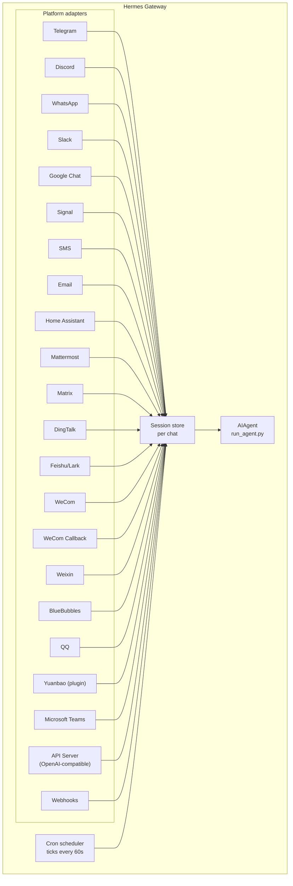

# Messaging Gateway

Chat with Hermes from Telegram, Discord, Slack, WhatsApp, Signal, SMS, Email, Home Assistant, Mattermost, Matrix, DingTalk, Feishu/Lark, WeCom, Weixin, BlueBubbles (iMessage), QQ, Yuanbao, Microsoft Teams, LINE, ntfy, or your browser. The gateway is a single background process that connects to all your configured platforms, handles sessions, runs cron jobs, and delivers voice messages.

For the full voice feature set — including CLI microphone mode, spoken replies in messaging, and Discord voice-channel conversations — see [Voice Mode](../features/voice-mode.md) and [Use Voice Mode with Hermes](../../guides/use-voice-mode-with-hermes.md).

:::tip
Bots need both a model provider and tool providers (TTS, web). A [Nous Portal](../../integrations/nous-portal.md) subscription bundles all of them.
:::

## Messaging status in Desktop and the dashboard

Messaging status belongs to the selected profile on the selected machine. Credentials
saved by `hermes gateway setup` can enable a credential-based platform without a
`platforms` entry in `config.yaml`; an explicit `platforms.<name>.enabled: false`
still disables it. A different profile never inherits the server process's credentials.
Platforms without required credential fields are not enabled merely because that list
is empty.

Naming the server's own profile explicitly (for example `profile=default` on a
default-profile server) gives the same status as an unscoped request. **Saved** means
credentials are stored, not that the messaging gateway is running or the platform is
connected. An enabled platform can correctly show **Messaging gateway stopped**.

## Platform Comparison

| Platform | Voice | Images | Files | Threads | Reactions | Typing | Streaming |
|----------|:-----:|:------:|:-----:|:-------:|:---------:|:------:|:---------:|
| Telegram | ✅ | ✅ | ✅ | ✅ | — | ✅ | ✅ |
| Discord | ✅ | ✅ | ✅ | ✅ | ✅ | ✅ | ✅ |
| Slack | ✅ | ✅ | ✅ | ✅ | ✅ | ✅ | ✅ |
| Google Chat | — | ✅ | ✅ | ✅ | — | ✅ | — |
| WhatsApp | — | ✅ | ✅ | — | — | ✅ | ✅ |
| WhatsApp Cloud API | ✅ | ✅ | ✅ | — | — | ✅ | — |
| Signal | — | ✅ | ✅ | — | — | ✅ | — |
| SMS | — | — | — | — | — | — | — |
| Email | — | ✅ | ✅ | ✅ | — | — | — |
| Home Assistant (plugin) | — | — | — | — | — | — | — |
| Mattermost | ✅ | ✅ | ✅ | ✅ | — | ✅ | ✅ |
| Matrix | ✅ | ✅ | ✅ | ✅ | ✅ | ✅ | ✅ |
| DingTalk | — | ✅ | ✅ | — | ✅ | — | ✅ |
| Feishu/Lark | ✅ | ✅ | ✅ | ✅ | ✅ | ✅ | ✅ |
| WeCom | ✅ | ✅ | ✅ | — | — | — | — |
| WeCom Callback | — | — | — | — | — | — | — |
| Weixin | ✅ | ✅ | ✅ | — | — | ✅ | — |
| BlueBubbles | — | ✅ | ✅ | — | ✅ | ✅ | — |
| Photon (iMessage) | ✅ | ✅ | ✅ | — | ✅ | ✅ | — |
| QQ | ✅ | ✅ | ✅ | — | — | ✅ | — |
| Yuanbao (Labs plugin) | ✅ | ✅ | ✅ | — | — | ✅ | ✅ |
| Microsoft Teams | — | ✅ | — | ✅ | — | ✅ | — |
| LINE | — | ✅ | ✅ | — | — | ✅ | — |
| ntfy | — | — | — | — | — | — | — |
| Raft | — | — | — | — | — | — | — |
| IRC | — | — | — | — | — | — | — |
| Buzz | — | ✅ | — | ✅ | — | — | — |
| SimpleX | ✅ | ✅ | ✅ | — | — | ✅ | — |

**Voice** = TTS audio replies and/or voice message transcription. **Images** = send/receive images. **Files** = send/receive file attachments. **Threads** = threaded conversations. **Reactions** = emoji reactions on messages. **Typing** = typing indicator while processing. **Streaming** = progressive message updates via editing.

:::note Hermes Relay
[Hermes Relay](./relay.md) (experimental) is not a chat platform itself — it is a connector system that fronts platforms like Discord, Telegram, Slack, and WhatsApp through an external connector that owns the platform credentials. Capabilities (media, native approval/clarify prompts, reactions, threads, typing, streaming) are negotiated per connector at handshake rather than fixed in the table above.
:::

## Architecture



Each platform adapter receives messages, routes them through a per-chat session store, and dispatches them to the AIAgent for processing. The gateway also runs the cron scheduler, ticking every 60 seconds to execute any due jobs.

## Intentional Silence Tokens

For group chats, hooks, and automation flows, Hermes supports explicit silence tokens. If the agent's final response is exactly one supported token, the gateway suppresses outbound delivery and sends nothing to the chat.

Supported tokens:

- `[SILENT]`
- `SILENT`
- `NO_REPLY`
- `NO REPLY`
- `[静默]` / `静默` and `[沉默]` / `沉默` — the Chinese renderings a model produces when it translates the sentinel instead of emitting it literally
- `[审核]` / `审核` — the label a lane drifts to when it answers "reviewed, nothing new" instead of emitting the sentinel

Whitespace and case are normalized, and whitespace *inside* the brackets is ignored too, so `[ SILENT ]`, `[SILENT ]` and `[ SILENT]` all silence. The whole final response still has to be the token — a sentence like "Use `[SILENT]` when nothing changed" is delivered normally.

Invisible *format* characters (zero-width space, zero-width joiner, BOM, bidi marks — Unicode category `Cf`) are ignored wherever they appear, so a token a model wrote as `[<U+200B>SILENT]` still silences instead of reaching the chat.

Silence is a delivery decision only. Hermes keeps the assistant silence turn in the session transcript, so the conversation still alternates normally:

```text
user: side-channel chatter
assistant: [SILENT]   # stored, not delivered
user: next message
```

Failed turns still surface as errors; Hermes does not hide failures just because the text resembles a silence token.

On a message from a person, a bare silence token is replaced by a short notice, because a message that needed a reply must not vanish. Internal wakes such as background-process notifications may stay silent, and so may a message the platform adapter reports as not addressed to the bot. Slack reports this for messages that open by @mentioning someone else and for unmentioned top-level messages that start a new thread in a free-response channel. Telegram reports it for [group messages not addressed to the bot](telegram.md#letting-the-bot-stay-silent-in-a-group). Other platforms always get the notice.

## Quick Setup

The easiest way to configure messaging platforms is the interactive wizard:

```bash
hermes gateway setup        # Interactive setup for all messaging platforms
```

This walks you through configuring each platform with arrow-key selection, shows which platforms are already configured, and offers to start/restart the gateway when done.

## Gateway Commands

```bash
hermes gateway              # Run in foreground
hermes gateway setup        # Configure messaging platforms interactively
hermes gateway install      # Install as a user service (Linux) / launchd service (macOS)
sudo hermes gateway install --system   # Linux only: install a boot-time system service
hermes gateway start        # Start the default service
hermes gateway stop         # Stop the default service
hermes gateway status       # Check default service status
hermes gateway status --system         # Linux only: inspect the system service explicitly
```

### Stack dump on demand (`SIGUSR2`)

On Linux and macOS, `kill -USR2 <gateway pid>` appends a dump of every thread's
stack to `~/.hermes/logs/gateway_faulthandler.log` and the gateway keeps
running — use it to see what a stalled or misbehaving gateway is doing without
restarting it.

### Built-in event-loop liveness watchdog

On every platform the gateway runs an out-of-loop watchdog thread that probes
the asyncio loop (`gateway.loop_watchdog_probe_interval_s`, default 30 s). When
the loop stops dispatching for `gateway.loop_watchdog_max_strikes` consecutive
probes (default 3), housekeeping, the cron scheduler and the embedded kanban
dispatcher have all frozen with it, so the watchdog dumps every thread's stack
to the log, stamps `gateway_state.json` with `gateway_state: degraded` and
`exit_reason: loop_liveness_watchdog`, and exits with code `75` so the service
supervisor restarts the process. `hermes gateway status` renders that record as
`⚠ Gateway exited degraded: event loop stopped dispatching …` until a new
gateway process overwrites it, and the dashboard's gateway badge shows
**Degraded** with the same reason. Set `gateway.loop_watchdog: false` in
`config.yaml` to disable the watchdog.

Housekeeping also re-stamps `gateway_state.json`'s `updated_at` every tick
(60 s), so it doubles as a heartbeat: when the process is still alive but that
stamp is more than 120 s old, `hermes gateway status` prints
`⚠ Gateway heartbeat stale: housekeeping has not refreshed gateway_state.json
for N s …` and the dashboard badge reads **Heartbeat stale** — the "looks
running but nothing is scheduled" case. Restart the gateway.

### Optional Linux event-loop watchdog

A systemd-managed gateway can opt into process recovery when Python's asyncio
event loop stops receiving scheduling time. This covers whole-process stalls
that also prevent platform-specific liveness tasks from running:

```yaml title="~/.hermes/config.yaml"
gateway:
  systemd_watchdog_seconds: 120
```

Regenerate the service unit after changing this setting:

```bash
hermes gateway install --force
```

A positive value makes the generated unit use `Type=notify`,
`NotifyAccess=main`, and the matching `WatchdogSec`. Hermes sends heartbeats
only while its event loop is making timely progress; systemd restarts the
process when they stop. The default `0` keeps the existing `Type=simple`
behavior. This setting is Linux/systemd-only and does not treat an ordinary
platform network disconnect as an event-loop failure.

Under `Type=notify` the gateway reports ready only after every served profile's
adapters connect, one profile at a time. Before each secondary profile's
connect it sends systemd `EXTEND_TIMEOUT_USEC` for that connect's budget plus
a margin. A large multi-profile boot can therefore run past systemd's default
90 s start timeout, while a boot that stops making progress is still killed.

## Chat Commands (Inside Messaging)

| Command | Description |
|---------|-------------|
| `/new` or `/reset` | Start a fresh conversation |
| `/model [provider:model]` | Show or change the model (supports `provider:model` syntax) |
| `/personality [name]` | Set a personality (`none` to reset) |
| `/retry` | Retry the last message |
| `/undo` | Remove the last exchange |
| `/status` | Show session info |
| `/whoami` | Show your slash command access on this scope (admin / user / unrestricted) |
| `/stop` | Stop the running agent |
| `/approve` | Approve a pending dangerous command |
| `/deny` | Reject a pending dangerous command |
| `/sethome` | Set this chat as the home channel |
| `/compress` | Manually compress conversation context |
| `/title [name]` | Set or show the session title |
| `/resume [name]` | Resume a previously named session |
| `/sessions [all] [search <query>]` | List previous sessions; `search <query>` filters by title or id |
| `/usage` | Show token usage for this session (`/usage reset [--force]` redeems a banked Codex limit reset) |
| `/insights [days]` | Show usage insights and analytics |
| `/reasoning [level\|show\|hide]` | Change reasoning effort or toggle reasoning display |
| `/voice [on\|off\|tts\|join\|leave\|status]` | Control messaging voice replies and Discord voice-channel behavior |
| `/rollback [number]` | List or restore filesystem checkpoints |
| `/bg <prompt>` | Run a prompt in a separate background session |
| `/btw <question>` | Ask a side question about the current conversation without interrupting it |
| `/reload-mcp` | Reload MCP servers from config |
| `/update` | Update Hermes Agent to the latest version |
| `/help` | Show available commands |
| `/<skill-name>` | Invoke any installed skill |

## Session Management

### Session Persistence

Sessions persist across messages until they reset. The agent remembers your conversation context.

### Finding Past Sessions (`/sessions`)

`/sessions` lists your previous sessions for the current chat — including the one you're in now, marked `(current)` — and `/sessions <name>` resumes one (shorthand for `/resume`). When the list grows long, `/sessions search <query>` (alias `find`) filters by title or session-id match, ordered by most recently active. Cross-origin listing with `/sessions all` is admin-only — regular users get a notice explaining the list stayed chat-scoped, and only ever see sessions from their own chat origin.

### Persistent `/model` Overrides

A `/model` switch in a gateway chat applies to that session and now **survives gateway restarts**: the model/provider choice is persisted to the session store and rehydrated on first use after a restart (credentials are re-resolved at load time and never written to disk). `/model reset` clears the override and keeps the conversation, `/new` (or `/reset`) clears it with a fresh conversation, and `/model <name> --global` writes it through to `config.yaml` instead. `/model <name> --once` applies for a single turn only.

### Delivery Reliability

Final agent responses are recorded in a durable **delivery ledger**
(`state.db`) around each platform send. If the gateway crashes or restarts
between producing a response and the platform confirming receipt, the next
boot redelivers the stored response instead of losing it — or re-running the
whole turn. The ledger lives in the home the gateway was started from; a
multiplexed gateway keeps every served profile's replies there too.

Semantics are honest at-least-once:

- A response whose send **never started** is redelivered as-is.
- A response that was **mid-send** when the gateway died (the platform may or
  may not have received it), including a redelivery an earlier boot was
  still sending, is redelivered with a visible
  "♻️ Recovered reply — … may be a duplicate" prefix. Ambiguity is labeled,
  never silently resent.
- A final send refused by **flood control** (such as Telegram rate limits) is retried automatically
  after the recorded penalty expires, without requiring a reconnect or restart.
  A restart during the penalty adopts the stored reply without spending a retry
  attempt or re-running the agent. Retries retain the original bot profile, chat
  and thread. A rate-limit recovery prefix warns that earlier chunks may already
  have arrived; the ledger cannot infer partial delivery from message length.
- Any other rejected final send (a platform 5xx, an unclassified error) is retried the same
  way after a growing backoff (30 s, then 2 min); the last budgeted attempt is left for the
  next gateway start, so an outage that outlasts the timer never strands the reply. A
  permanently unreachable chat (blocked bot, deleted group) is not retried.
- Redelivery is bounded: 3 attempts, 24-hour freshness, then the row is
  abandoned. Delivered rows are pruned after 7 days.

Disable with `gateway.delivery_ledger: false` in `config.yaml` (restores the
old behavior: in-flight responses are lost on crash).

### Session continuity

Gateway conversations do not reset after inactivity or at a daily boundary. Use `/new`
or `/reset` for an explicit new conversation; context compression remains automatic.
Core ignores legacy `session_reset` settings, reset-policy overrides and reset-timer
environment variables. If your config still sets `session_reset.mode` to `idle`, `daily`
or `both`, gateway startup and `hermes doctor` warn about it. To keep time-based resets,
install the catalog plugin that reads the same block unchanged:
`hermes plugins install hermes-session-reset-policy`. Cached agents may be released to reclaim resources without
replacing the durable conversation. Restart-recovery freshness limits automatic
continuation, not the history loaded when you send a message.


## Per-Channel Model & System Prompt Overrides

Different channels can run different models and personas from a **single gateway** — e.g. a cheap fast model in `#daily` and a frontier model with a specialist prompt in `#dev`. Configure `channel_overrides` under the platform in `~/.hermes/config.yaml`:

```yaml
platforms:
  discord:
    enabled: true
    channel_overrides:
      "123456789012345678":        # channel/thread id
        model: anthropic/claude-sonnet-4.6
        provider: anthropic
        system_prompt: "You are the #dev channel code-review specialist."
      "987654321098765432":
        model: openai/gpt-5-mini
```

Details:

- `model`, `provider`, and `system_prompt` are optional. Unset fields fall back to the global defaults. A room can also set intentional silence with `allow_silence`, which overrides the platform's own `allow_silence` (below).
- Lookup order is exact channel/thread id first, then the **parent** channel/forum id — so Discord threads inherit their parent channel's override automatically.
- Resolution priority for the model is: session `/model` override → `channel_overrides` → global config. A user running `/model` in a chat still wins over the channel default.
- The `system_prompt` override replaces the global gateway prompt for that channel (it is ephemeral — injected per turn, not stored in history).

A related mechanism, `channel_model_bindings`, binds a model/provider to a channel without a system prompt — see the per-platform docs (Discord, Slack, Telegram, Mattermost, WhatsApp). Both are overridden by a session-scoped `/model` switch.
